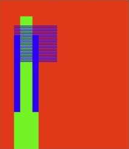
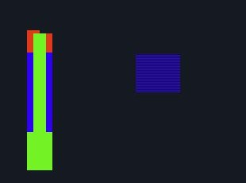
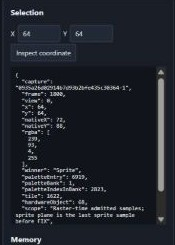
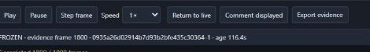
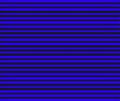

# NEO REAPER - Geolith

A local Neo Geo AES/MVS reverse-engineering workbench built around [Geolith](https://github.com/libretro/geolith-libretro). This repository contains the REA integration and a pinned upstream source submodule. Neo Geo Pocket and CD are outside the initial integration scope.

The [v0.1.0 release](https://github.com/Bertzerker/NEO-REAPER-Geolith/releases/tag/v0.1.0) provides a Windows x64 build with the **Sprite & tile catalog** and tracked frame attachments. Extract the ZIP and run the launcher with PowerShell 7 and the .NET 10 x64 runtime. See [build/run and API instructions](rea/README.md), [measured validation](rea/VALIDATION.md), [actual scope](rea/SPEC.md) and [feature parity](rea/PARITY.md). Supply your own Neo Geo cartridge and system firmware.

The source build uses **Geolith at `2dc88e3`**. See [core selection](rea/CORE-SELECTION.md) for the full commit and integration scope. Click any crop to enlarge it.

| Feature | Cropped example |
| --- | --- |
| **Sprite strips and FIX.** Inspect Composite, the sprite plane and FIX from the same native frame. Browse strip priority with the mouse wheel and pick a chain or a group. Scenery can use the same 16×16 tile strips as characters, while FIX uses 8×8 tiles. | <a href="docs/rea-features/graphics.jpg"></a> <a href="docs/rea-features/layers.jpg"></a> |
| **Pixel and memory evidence.** Pin a capture and inspect available strip, tile and palette information. Read copied memory and registers, compare baselines, or query an immutable cartridge region through its verified identity. | <a href="docs/rea-features/inspection.jpg"></a> |
| **Execution and input replay.** Step a frame, run a bounded two-pad experiment or restore a compatible checkpoint. Record an input movie and replay it from its starting state. The replay checks completed rows for divergence. | <a href="docs/rea-features/controls.jpg"></a> |
| **Catalog and tracked comments.** Add to named sprite groups, sprite tiles and FIX tile entries as you inspect frames. Isolate matches and follow an occurrence in live play or replay. Attach the exact tracked frame and catalog revision to a comment, reopen it later, and verify the exported evidence hashes. The crop comes from a saved FIX attachment. | <a href="docs/rea-features/catalog.jpg"></a> |

Sprite tile matching uses the last admitted sprite sample before FIX. The priority inspector can display covered strip writes. Their tile IDs are unavailable in the saved priority raster.

From the extracted release, launch with your local assets.

```powershell
./rea/Start-REA.ps1 -Rom 'C:/local/game.neo' -Firmware 'C:/local/neogeo.zip' -System MVS -Wait
```

For a source build and an original diagnostic, initialize the submodule and run the following commands. The diagnostic requires Python and generates its assets locally.

```powershell
git submodule update --init --recursive
./rea/Build.ps1
./rea/Start-REA.ps1 -Diagnostic -Wait
```

Open [the local workbench](http://127.0.0.1:8910/). Original diagnostic fixtures are test-only and do not replace retail firmware. A locally supplied Metal Slug cartridge and US MVS BIOS were separately tested; that evidence stays private and ignored. AES retail compatibility and special cartridge boards remain unverified/unsupported as documented.

Geolith is copyright Rupert Carmichael and contributors, BSD-3-Clause, with dependency notices retained in its source. New NEO REAPER integration code is MIT licensed unless a file states otherwise.
