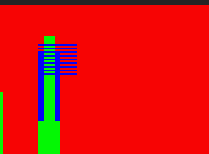
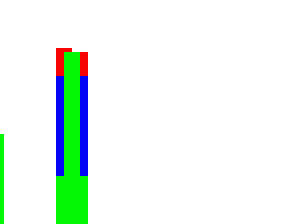

# Validation — 5 November 2026

These checks executed the compiled Geolith C DLL and .NET host. No mocked producer establishes any native result below. Exact binaries/configurations/asset-region hashes are recorded in ignored `rea/bin/build-manifest.json`, session manifests and machine-readable reports under `rea/test-output/`. Commercial asset bytes and private game evidence are excluded from Git and were not exported.

A clean local clone built both the DLL and host successfully. A separate clone in a path containing spaces and `é` also built and passed the native AES diagnostic. The build uses a BOM-tagged UTF-8 compiler response file and UTF-16 environment path variables in its ASCII-only batch helper; PowerShell 7 is explicit.

## Native diagnostic

`native_test.py` passed independently in AES/US and MVS/US with the original test-only firmware and original cartridge generated by `diagnostic.py`. That firmware contains minimal reset vectors and artificial vertical-zoom tables, not a retail BIOS implementation. These tests establish the declared diagnostic behavior, not general AES/MVS commercial compatibility.

- 68000 writes known `12 34` RAM bytes and copies active-low controller/status bytes into RAM. Digital directions/A–D use bits 0–7; Start and AES Select/MVS Coin mappings were checked for both players and both machine modes. Pressing A changes actual native output as well as copied RAM.
- Actual sprite overlap/order, FIX overlap/transparency, horizontal zoom/chaining and clipping/wrapping render through Geolith. Palette entry 1 changes red → blue → green at emulated scanlines 32/100/200. The captured sprite retains red/blue raster samples while end-boundary palette memory is green.
- Every visible admitted sprite/FIX sample matches its documented composition into the normal final framebuffer. No layer toggle or second render was used. Visible crop is 304×224 at native (8,24).
- Native state and final video are byte-identical after checkpoint restore and replay, with observation enabled/disabled. Generated nonzero SSG audio is also identical. The fixture's Z80 updates sound RAM while generating a tone.
- Initial restore tests exposed missing upstream sprite-line scheduling, YMFM resampler/FM preparation context and Musashi reset/stop/exception context. Integration state extensions preserve those pointer-free fields; subsequent same-process and cold-process tests pass. This is evidence for tested paths, not a proof of every possible title/device state.

Real native diagnostic output (all image content is original/redistributable):

## Actual API and persistence

`integration_test.py rea/bin 8914` passes ten acceptance groups against an isolated owned native host:

1. Native startup and explicit pre-first-capture state.
2. Token/Origin/body/mask/frame bounds rejection.
3. Copied RAM bus order, clipped end reads, on-demand verified immutable assets, dual leases, eviction and differences; expired unleased evidence returns 410.
4. Lossless native images, source-specific pixel fields and admitted hardware-strip coverage bounds.
5. Malformed client WebSocket data rejected with policy close; eight reconnects release bounded viewer slots.
6. Named persistent checkpoint restore, incompatible identity rejection and stale-render invalidation until a fresh frame.
7. A 60-row recording replayed twice with authoritative pad input and state/video/generated-audio checks at every boundary; incompatible movie identity rejected.
8. Durable comment revisions, stale-write conflicts, JSON validation and offline verification of an evidence ZIP, including immutable note revisions and matching movie data where linked. The verifier checks every manifest hash plus capture/note/movie identity consistency without extraction/execution.
9. Pause interrupts a 3600-frame experiment at a completed boundary and reports actual versus requested frames.
10. Cold host restart preserves saved review and comment revisions, and the input movie replays without divergence from its embedded checkpoint.

The original diagnostic test exports contain no commercial assets. Tests terminate only their own process handles and use isolated ignored data directories. No unrelated emulator sessions are terminated.

## Supplied Metal Slug and firmware

The user supplied `roms/mslug.zip` and `roms/neogeo.zip`. The original archives remain unchanged. `convert_mslug.py` verifies all nine canonical component SHA-1 values against the [MAME driver mapping](https://github.com/mamedev/mame/blob/master/src/mame/snk/neogeo.cpp). This set's legacy C ROMs require swapping equal halves; the transformed bytes match the canonical hashes. The converter rotates the P ROM's 1 MiB halves, interleaves canonical C pairs, concatenates V sample regions, and writes ignored `roms/mslug.neo` plus an ignored conversion manifest. No replacement asset was downloaded.

Validated configuration: **US MVS**, supplied **`sp-u2.sp1`**, supplied `000-lo.lo`, `sfix.sfix`, `sm1.sm1`, standard default-board Metal Slug NGH `0x201`, two digital pads, resistor-network palette, standard crop. The game reaches its title sequence and rendered gameplay after coin/start inputs.

`compatibility_test.py roms/mslug.neo roms/neogeo.zip` boots 1800 frames, then checks a 220-frame coin/release/start/release/right+A/release sequence. Observation on/off produces identical full declared state, native video and generated audio at every tested row. A separate cold process restores and replays those rows without divergence. The short native step timing sample measured approximately 2.415 ms mean with observation and 2.334 ms without (about 3.47% mean overhead); p95 was 3.074/3.218 ms respectively. This short sample is noisy and applies to this workload, not a universal overhead bound.

`game_workbench_test.py roms/mslug.neo roms/neogeo.zip` separately passes the **shipped production checkpoint/movie API**, including checkpoint invalidation, 220 recorded input rows, two replays and a third replay after host restart. State, video and audio hashes are checked at every row. It does not export game evidence. Private native screenshots, states, movies, manifests and reports remain under ignored `rea/test-output/private-mslug/`.

Commercial AES remains **unverified**: this supplied firmware pack has no `neo-epo.bin`/`neo-po.bin`. AES original-diagnostic tests are listed separately. Other games, regions, special boards/controllers, long gameplay, multi-slot, CD and hardware-perfect timing are not certified by this one-title result.

## Sustained performance

Final-build US MVS / supplied Metal Slug / `sp-u2.sp1`, one consuming lossless WebSocket, 180.02 seconds:

| Measurement | Result |
| --- | --- |
| Native frames / configured cadence | 10654 / 59.185606 Hz |
| Native frame rate | 59.183 frames/s |
| Copied captures | 2663 · 14.793/s |
| Unique delivered atlas messages | 1319 · 7.327/s |
| Intentionally skipped capture IDs between sends | 1342 (latest-only delivery) |
| Native step p95 | 3.623 ms |
| Capture copy/state-hash p95 | 1.257 ms |
| Process working-set range | 150.9–271.4 MB |
| Last 30-second working-set range | 165.9–209.6 MB |
| Retained streaming history | 8 captures |

The report's DLL/host hashes match the local final build manifest. Private asset fingerprints and raw evidence stay in ignored reports. There was no producer queue blocking on network delivery; capture copying was throttled to every fourth running frame. Sender count differs slightly from capture count minus skips because the handshake, initial send and final sampling boundaries are separate.

An earlier original-diagnostic AES host run sustained 180.06 seconds: 59.59 native frames/s against 59.599484 configured Hz; 14.90 captures/s and 7.26 delivered atlases/s. History stayed at eight; working set ranged 96–174 MB and the last 30 seconds ranged 105–121 MB. A separate unthrottled diagnostic sample measured 799 frames/s with observation off (10 seconds) versus 708 on (30 seconds), about 12.93% mean native-step overhead. These earlier measurements retain their own binary identities; they are not benchmarks of unrelated ROMs or browser presentation.

Delivery counts describe a consuming WebSocket client, **not unique GPU presentations**. The browser separately counts unique presented capture IDs and reports source/capture/presentation rates independently. Encoding is detached and latest-only: slow viewers intentionally skip capture IDs rather than blocking the emulation owner. Working-set observations and finite retention are boundedness evidence for the measured duration, not a leak proof or a frame-perfect smoothness guarantee.

## Browser journeys

Codex in-app browser only; no browser switch was used. Reports/screenshots are local in `rea/test-output/`.

- Live pixel selection held capture/frame 1 while the actual machine advanced to frame 576. Pixel, copied RAM and registers retained that selected ID.
- A response for x=10 was held through a local development interception until x=20 had displayed; releasing the older response did not overwrite the new selection. Interception was cleared afterward.
- Saved capture from a previous host session reopened after server restart, displaying saved frame 1 while the current machine remained at frame 2. No core restore occurred.
- Two tabs editing one revision produced an explicit stale-save conflict and preserved text. Durable drafts are isolated per tab; the recovery picker recovered a stored copy from another tab without replacing the original. Explicit discard and dirty-navigation blocking were exercised.
- Markdown script markup was removed, JSON was validated/formatted, and strict Mermaid rendered readable SVG labels. Root `htmlLabels:false` is required by the bundled Mermaid version; no unsanitized foreign-object HTML is admitted.
- Keyboard arrows changed inspection coordinates and Enter inspected the pinned pixel. Optional controller input remains focus-scoped and separate from keyboard inspection.
- Effective 1440×900 and 1024×768 CSS viewports had document scroll widths 1420/1004; exact 390×844 mobile emulation had scroll width 390. Initial browser-scoped viewport requests produced other effective sizes; tab-scoped developer metrics established these actual dimensions. The narrow layout stacks without page-wide horizontal overflow.
- 200% **visual viewport zoom** was exercised (scale 2, visual width 195 at layout width 390). True desktop-browser 200% zoom/reflow remains unverified; it is not conflated with this mobile visual zoom check. General accessibility conformance is not claimed.

## Remaining limits

No audio speaker playback, instruction/access trace, exact CPU/DMA fetch chain, software collision geometry, source-map graphics card or timeline editor is implemented. Source winner classification is available per pixel and in exported native evidence. Vertical-zoom correctness is not certified by the artificial diagnostic tables. The default renderer's instruction-level raster timing is inherited; no cycle-perfect hardware claim is made. Captures currently allocate detached arrays rather than pooling. The sustained delivery rate is lower than capture cadence; improving atlas encoding/sharing is measured optimization work, not hidden by calling delivery game FPS.

Build/run/test commands and exact route examples are in [README](README.md); delivered semantics/backlog in [SPEC](SPEC.md). No public release or binary package was created.
